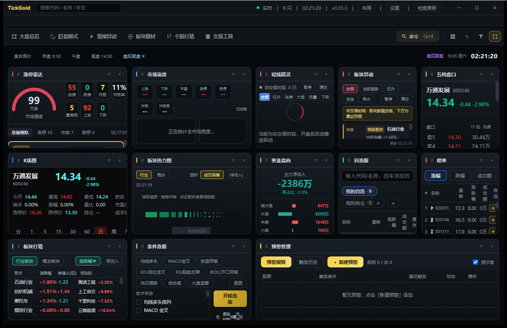
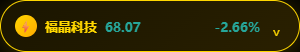
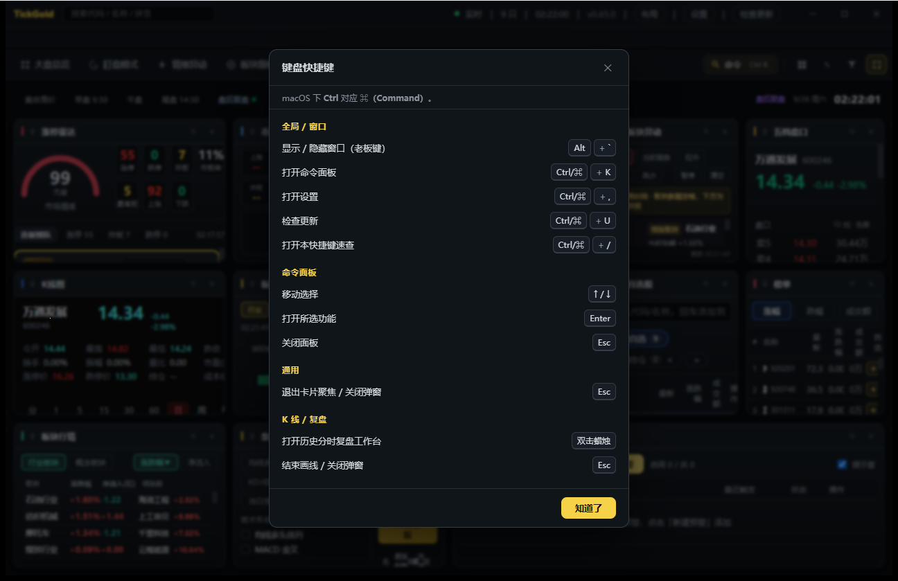

# TickGold

> 为「交易者盯盘」而生的跨平台 A 股桌面终端。比传统交易软件更轻、更快、更专注盘中。
> **Tauri 2.0（Rust）+ Vue 3 + TypeScript**，一套代码同时发布 Windows 与 macOS（Apple Silicon / Intel）。

---

## 截图

*主工作台：涨停雷达、市场宽度、板块热力图、K 线、资金流向、自选股、榜单、条件选股、预警管理，一屏看全盘面。*

*灵动岛悬浮条：常驻屏幕顶部，显示当前标的价格与涨跌幅，老板键一键隐藏。*

*快捷键速查面板：`Ctrl/⌘ + /` 随时呼出，全键盘可操作。*

> 截图拍摄于 v0.65.0，最新 v2.27.0 界面已新增 Mega 菜单、AI 问数、快脑决策等功能，最新截图将在交易日补拍更新。

---

## 核心特性

**卡片化动画工作台**
- 所有功能模块都是可自由开关的「卡片」，Mega 功能菜单或命令面板（`Ctrl+K`）一键打开/关闭
- 通用装箱布局引擎，任意数量卡片自动均匀铺满；支持自由拖拽、磁吸 resize、场景模板一键切换
- 9 套配色主题（鎏金奢华 / 极地冰蓝 / 熔岩钛橙 / 曜石黑金 / 同花顺经典白等），界面缩放四档，高对比模式

**灵动岛双形态**
- 常驻顶部灵动岛悬浮条，显示当前标的价格涨跌幅，点击展开主窗口
- 全局老板键 `Alt + \`` 一键显示/隐藏，画中岛独立悬浮窗可把分时图/盘口外摆到屏幕一角

**实时盯盘**
- 榜单、市场情绪、板块热力图、资金流向、五档盘口、短线精灵，多数据源容灾（腾讯主源 + 新浪/东财备份）
- 卡片智能轮询：不可见/最小化自动暂停，恢复即刷新；Rust 全局 HTTP 并发闸门，断网自动续传

**分时复盘**
- 双击 K 线蜡烛进入复盘工作台：逐分钟回放（1/2/4/8 倍速）、多日分时叠加（2/3/5 日）、分时量比副图
- 画线工具 15 种，按股票+周期持久化；技术指标 20+ 种，参数可视化编辑

**智能预警**
- 价格边沿触发、跳水、涨停/跌停封板、炸板、换手率、成交额等多类条件
- 触发即系统通知 + WebAudio 提示音，触发历史持久化可回看

**AI 问数与快脑决策**
- AI 问数助手：自然语言提问盘面/题材/资金，自动调用只读工具并附引用
- 快脑决策闭环：盘中规则快脑实时输出信号，模拟盘全自动撮合，决策日志可回放
- 信号人工确认桥：信号不自动真实下单，人工确认后生成指令，全程审计

**辅助工具**
- 模拟交易、投资计算器、数据导出（CSV/JSON）、盯盘日记、条件选股、F10、经济/新股日历

**健壮性与更新**
- 内置自动更新：多镜像容灾（ghproxy / gh-proxy / 官方直连）+ minisign 签名校验 + 安装前数据库备份
- 单卡错误边界，前端全局错误归集，Rust 分级日志，诊断日志一键导出
- 本地优先：自选股、布局、预警等均保存在本机 SQLite，不上传服务器

---

## 下载安装

前往 [Releases](https://github.com/mhxy881126/tickgold-public/releases/latest) 下载对应平台安装包：

| 平台 | 文件 |
| --- | --- |
| Windows x64 | `TickGold_<版本>_x64-setup.exe`（图形化向导，支持自定义安装路径） |
| macOS Apple Silicon (M 系列) | `TickGold_<版本>_aarch64.dmg` |
| macOS Intel | `TickGold_<版本>_x64.dmg` |

**Windows**：双击运行安装包，按向导完成安装（默认安装到当前用户目录，无需管理员权限）。首次运行若 SmartScreen 提示，点击「更多信息 → 仍要运行」即可。

**macOS**：挂载 `.dmg` 后将 TickGold 拖入「应用程序」。首次运行若提示无法验证开发者，到「系统设置 → 隐私与安全性」中点击「仍要打开」。

**覆盖安装/在线升级**：直接运行新版安装包即可，安装器会自动结束正在运行的 TickGold 并等待文件释放，无需手动卸载。应用内也支持 `Ctrl/⌘+U` 检查更新，自动下载签名安装包。

详细安装步骤见 [用户手册 · 安装与卸载](docs/用户手册.md)。

---

## 完整文档

更多文档位于 [`docs/`](docs/README.md)：

- [用户手册](docs/用户手册.md)：安装卸载、界面、功能、设置、更新、数据与隐私
- [键盘快捷键](docs/快捷键表.md)：完整快捷键列表
- [数据源说明](docs/数据源说明.md)：行情接口、字段口径、已知限制
- [第三方 License](docs/第三方License.md)：开源依赖与合规说明
- [截图与演示](docs/截图与演示.md)：官方截图、演示视频脚本
- [常见问题 FAQ](docs/常见问题.md)：高频问题解答

---

## 关于本仓库

本仓库（`tickgold-public`）是 TickGold 的**产品官网与 Release 二进制包托管仓库**：

- ✅ 包含：产品官网页面、用户文档、截图、Release 签名安装包
- ❌ 不包含：应用业务源码（`src/`、`src-tauri/` 等）

应用源码在私有仓库 `tickgold` 中维护，通过 CI 构建后将 minisign 签名的安装包发布到本仓库的 Releases。本仓库的官网页面与文档以 MIT 协议开源。

---

## 免责声明

行情数据来自公开免费接口，仅供学习与个人盯盘参考，不保证实时性与准确性，**不构成任何投资建议**。本项目不提供真实委托下单（需券商资质），仅可用于模拟交易。
